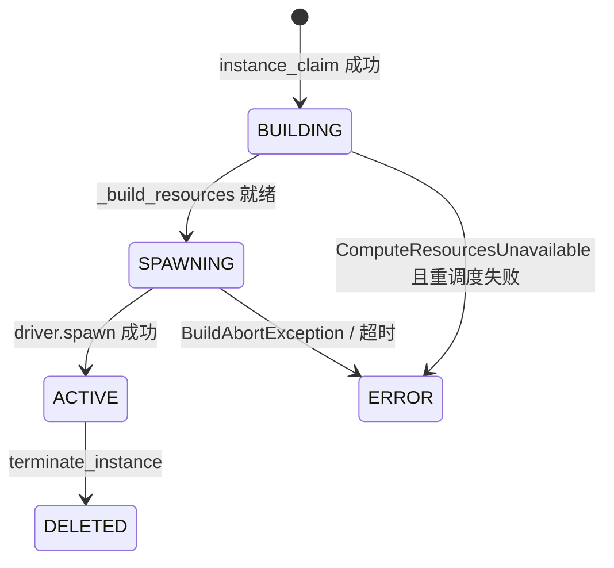

# `compute-worker`（定时调度 / 异步队列 / Worker 组件）

`nova-compute` 是每台宿主机上的执行 Worker：它接收 conductor 的 RPC 指令执行实例状态机，并通过 `oslo_service.periodic_task` 驱动 16+ 个周期任务做状态收敛。它是全仓唯一允许直连 hypervisor 的进程，同时被强制禁止直连 DB。

## 1. 后台任务类型全集（Job Registry）

| 任务标识（Kind） | 触发源 | 间隔 / 超时阈值（配置键） | 执行主函数（`路径:行号`） | 最终状态/产物落点 |
|---|---|---|---|---|
| `build_and_run_instance` | conductor RPC cast (`nova/conductor/manager.py:610`) | claim 资源预留 | `nova/compute/manager.py:1702` / `_build_and_run_instance:1901` | 虚机 `ACTIVE` / `ERROR` |
| `_sync_power_states` | 周期任务 | `sync_power_state_interval` | `nova/compute/manager.py:6303`（装饰器 `:6301`） | 对齐 DB `power_state` |
| `update_available_resource` | 周期任务 | `update_resources_interval` | `nova/compute/resource_tracker.py:624` | `compute_nodes` 账本 |
| `_run_image_cache_manager_pass` | 周期任务 | `image_cache_manager_interval` | `nova/compute/manager.py:6921` | 镜像缓存清理 |
| `_reclaim_queued_deletes` | 周期任务 | `reclaim_queue_delete_interval` | `nova/compute/manager.py:6539` | 排队删除回收 |
| `_poll_unconfirmed_resizes` | 周期任务 | `resize_time_out` | `nova/compute/manager.py:5994` | resize 确认/回滚 |

## 2. 执行流与并发控制调用树

```text
nova/compute/manager.py:1702 build_and_run_instance(...) [加锁 _locked_do_build_and_run_instance :1709]
  └─ nova/compute/manager.py:1760 _do_build_and_run_instance
       └─ nova/compute/manager.py:1901 _build_and_run_instance
            ├─ [claim] :1921 rt.instance_claim(context, instance, node, limits)
            │    └─ 失败 -> exception.ComputeResourcesUnavailable (:1958) -> RescheduledException 重调度
            ├─ [resources] :1928 self._build_resources(...) -> 网络/卷/镜像就绪
            ├─ [state] :1931 vm_state=BUILDING, task_state=SPAWNING
            ├─ [spawn] :1943 self.driver.spawn(...) -> hypervisor 落机
            └─ [error] :1950 InstanceNotFound / :1967 BuildAbortException -> create.error 通知
```

## 3. 任务状态机与阶段契约



| 状态存储与轮询机制 | 代码实现细节 | 源码锚点（`路径:行号`） |
|---|---|---|
| 实例状态字面量 | `vm_states.ACTIVE/BUILDING/ERROR` 等 | `nova/compute/vm_states.py:34` |
| 瞬态任务字面量 | `task_states.SCHEDULING/NETWORKING/SPAWNING` 等 | `nova/compute/task_states.py:29` |
| 资源账本 | `ResourceTracker.instance_claim` / `update_available_resource` | `nova/compute/resource_tracker.py:152` / `:624` |
| 进程重启影响 | 周期任务随 `Service.start` 重新注册，内存 task 态由周期任务按 DB/hypervisor 对齐恢复 | `nova/service.py:138` / `nova/manager.py:104` |

## 4. 共变耦合与修改清单（Agent Co-Change Playbook）

- **修改阶段枚举或 spawn 逻辑**：必须同步检查 `nova/compute/vm_states.py`、`nova/compute/task_states.py` 与前端/CLI 展示的状态字面量，并跑 `nova/tests/unit/compute/test_compute.py`。
- **新增周期任务**：用 `@periodic_task.periodic_task(spacing=...)` 装饰（`nova/compute/manager.py:5858` 等为范例），注意并发隔离与超时。
- **claim 逻辑变更**：动 `nova/compute/resource_tracker.py:152` 必须跑 `nova/tests/unit/compute/test_resource_tracker.py`，并验证调度容量一致性。
