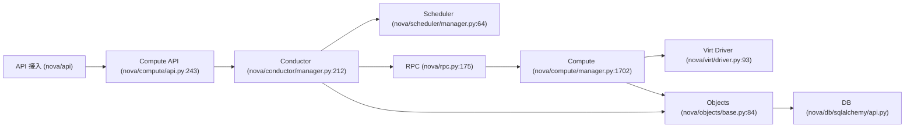

# 仓内模块依赖矩阵与影响面图谱

本页刻画 Nova 各模块之间的真实调用边、高扇入底座枢纽与 RPC 异步边界。Nova 是单仓多进程结构，模块依赖分两类：进程内同步 import 调用，以及经 `nova/rpc.py` 的跨进程 cast/call（静态 import 图无法覆盖，须显式标注）。

## 1. 模块依赖拓扑图

## 2. 模块×模块真实调用边明细

| 调用方模块（Caller） | 被调方模块（Callee） | 耦合介质（Import 调用 / RPC / 共享表） | 契约符号 | 证据锚点（`路径:行号`） |
|---|---|---|---|---|
| [`api-service`](api-service.md) | `compute/api.py` | 同步函数调用 | `API.create` | `nova/api/openstack/compute/servers.py:502` 调 `self.compute_api` |
| `compute/api.py` | `conductor/rpcapi.py` | RPC cast | `ConductorAPI.build_instances` | `nova/compute/api.py` 调 conductor（经 `nova/conductor/rpcapi.py:328`） |
| `conductor/manager.py` | `scheduler/manager.py` | RPC call | `SchedulerManager.select_destinations` | `nova/scheduler/manager.py:105` |
| `conductor/manager.py` | `compute/rpcapi.py` | RPC cast | `build_and_run_instance` | `nova/conductor/manager.py:610` |
| `compute/manager.py` | `virt/driver.py` | 多态接口调用 | `ComputeDriver.spawn` | `nova/compute/manager.py:1943` → `nova/virt/driver.py:264` |
| `objects/*` | `db/sqlalchemy/api.py` | 对象持久化 | `NovaPersistentObject` | `nova/objects/base.py:154` / `nova/db/sqlalchemy/api.py` |
| 全部服务 | `rpc.py` | RPC 底座 | `get_client` / `get_server` | `nova/rpc.py:175` / `nova/rpc.py:189` |

## 3. 变更爆炸半径与架构审计（Blast-Radius Audit）

- **高扇入核心底座（High Fan-In — 改签名必须全仓搜索调用点并跑全量单测）**：
  1. `nova/rpc.py`（被 conductor/scheduler/compute/cells 全部依赖）：核心契约 `get_client`/`get_server`/`get_notifier`（`nova/rpc.py:175`/`:189`/`:205`）。
  2. `nova/objects/base.py`（被全部领域对象依赖）：核心契约 `NovaObject`/`NovaObjectSerializer`（`nova/objects/base.py:84`/`:184`），改序列化格式影响所有跨进程对象。
  3. `nova/exception.py`（2182 行，被全仓依赖）：核心契约 `NovaException`（`nova/exception.py:58`），改异常层级影响错误映射。
  4. `nova/conf/`（50+ 选项组）：改选项名影响 `nova/conf/opts.py:43 list_opts` 生成的样例配置。
- **循环依赖与延迟导入记录**：Conductor 通过 `indirection_api` 反转对象持久化方向（`nova/cmd/compute.py:47` 设 `NovaObject.indirection_api = ConductorAPI()`），compute 侧对象 `save` 实际回调 conductor，属设计性反向依赖而非循环 bug。
- **内嵌/跨进程边界约定**：`nova/virt/` 在运行时由 `setup.cfg:84-88` 的 stevedore 入口动态选择驱动（`filter_scheduler` 等同理），改驱动接口须同步所有 `nova/virt/<driver>/driver.py` 实现。

## 4. 跨仓依赖矩阵（`repo_deps`）

单仓模式：本仓无同工作区多仓依赖。外部下游系统（Glance/Cinder/Neutron/Ironic/Keystone/RabbitMQ/MySQL）均为仓外黑盒，其出向契约见 [`integrations/index.md`](../integrations/index.md) 与 [`boundary.md`](../operations/boundary.md)，不计入仓到仓依赖边。

- **跨仓环检测结论**：不适用（单仓模式）。

高扇入底座的隐式陷阱与历史死路径见 [高危雷区与历史陷阱](../operations/pitfalls-and-adr.md)。
