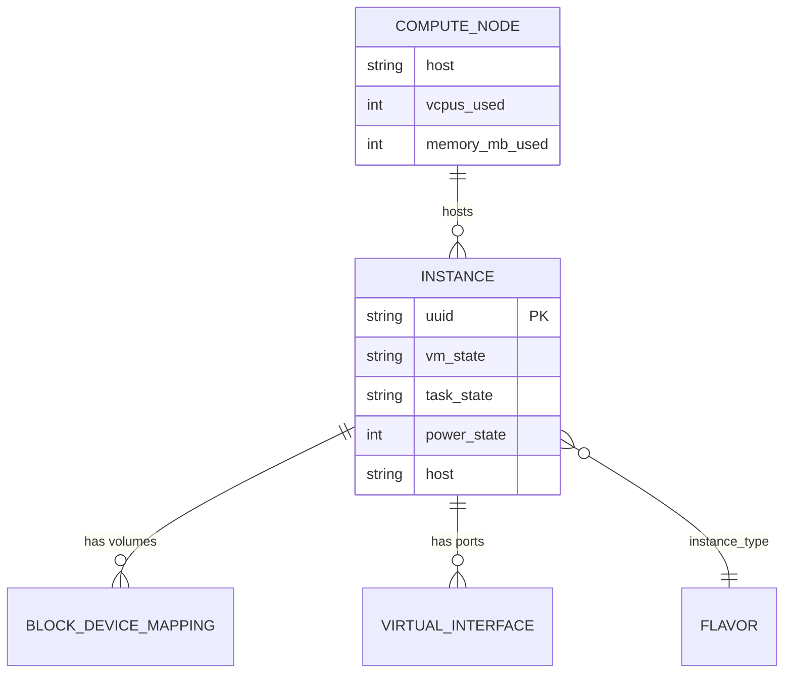

# 核心领域与数据模型总览

Nova 的领域模型采用「带版本领域对象（`nova/objects/`）+ SQLAlchemy ORM 表（`nova/db/sqlalchemy/models.py`）」双层结构：业务代码只操作领域对象，持久化经 `NovaPersistentObject`（`nova/objects/base.py:154`）与 conductor 代理完成。本页给出核心实体的关系、字段字典与读写归属。

## 1. 实体与存储关系图

## 2. 精确字段字典（Exact Schema Dictionary）

> 字段名、类型取自领域对象 `fields` 定义与 ORM 列定义，禁止推测未定义字段。

### `Instance`（`nova/objects/instance.py:109`，VERSION `'2.3'`）

| 字段 / JSON 键路径 | 类型 | 必填 / 默认值 | 枚举值集合与业务约束 | 定义/校验源码锚点（`路径:行号`） |
|---|---|---|---|---|
| `id` | `IntegerField` | 自动生成 | 数据库主键 | `nova/objects/instance.py:118` |
| `user_id` / `project_id` | `StringField(nullable=True)` | 可选 | 租户归属 | `nova/objects/instance.py:120-121` |
| `image_ref` | `StringField(nullable=True)` | 可选 | 镜像引用 | `nova/objects/instance.py:123` |
| `power_state` | `IntegerField(nullable=True)` | 可选 | hypervisor 电源状态 | `nova/objects/instance.py:133` |
| `vm_state` | `StringField(nullable=True)` | 可选 | `ACTIVE`/`BUILDING`/`ERROR` 等 | `nova/objects/instance.py:134` / `nova/compute/vm_states.py:34` |
| `task_state` | `StringField(nullable=True)` | 可选 | `SCHEDULING`/`SPAWNING` 等瞬时态 | `nova/objects/instance.py:135` / `nova/compute/task_states.py:29` |
| `memory_mb` / `vcpus` / `root_gb` / `ephemeral_gb` | `IntegerField(nullable=True)` | 可选 | 资源规格 | `nova/objects/instance.py:138-141` |
| `host` / `node` | `StringField(nullable=True)` | 调度后 | 所在宿主机/节点 | `nova/objects/instance.py:144-145` |

### `Flavor`（`nova/objects/flavor.py:209`）

| 字段 | 类型 | 默认值 | 定义源码锚点 |
|---|---|---|---|
| `memory_mb` / `vcpus` / `root_gb` | `IntegerField` | 必填 | `nova/objects/flavor.py:219-221` |
| `flavorid` | `StringField` | 必填 | `nova/objects/flavor.py:223` |
| `rxtx_factor` | `FloatField` | `1.0` | `nova/objects/flavor.py:225` |

### `ComputeNode`（`nova/db/sqlalchemy/models.py:110`，表 `compute_nodes` `:113`）

| 字段 | 类型 | 约束 | 定义源码锚点 |
|---|---|---|---|
| `vcpus` / `memory_mb` / `local_gb` | `Integer` | `nullable=False` | `nova/db/sqlalchemy/models.py:130-132` |
| `vcpus_used` / `memory_mb_used` / `local_gb_used` | `Integer` | `nullable=False` | `nova/db/sqlalchemy/models.py:133-135` |
| `running_vms` / `free_ram_mb` / `free_disk_gb` | `Integer` | 周期由 resource tracker 写回 | `nova/db/sqlalchemy/models.py:143-146` |

## 3. 全库存储介质与读写归属矩阵（Writer / Reader Ownership）

| 存储载体（DB 表） | 精确表名 | 权威写入方（Writers + `路径:行号`） | 读取消费方（Readers + `路径:行号`） | 并发与原子性机制 |
|---|---|---|---|---|
| ORM: 实例 | `instances`（`nova/db/sqlalchemy/models.py:202`，`uuid` 唯一 `:224`） | conductor 经 `nova/db/sqlalchemy/api.py` | API / scheduler / compute（经对象层） | `Instance.save(expected_task_state=...)` 乐观锁（`nova/compute/manager.py:1936`） |
| ORM: 计算节点 | `compute_nodes`（`:113`） | `ResourceTracker.update_available_resource` (`nova/compute/resource_tracker.py:624`) | scheduler host_manager | 周期覆盖写，资源账本 |
| 领域对象序列化 | 跨进程 primitive | `NovaObjectSerializer.serialize_entity` (`nova/objects/base.py:242`) | 反序列化 `:251` | 带版本号兼容 |

## 4. 字段增删改共变清单（Schema Change Playbook）

- 新增/重命名字段必须同步更新：`nova/db/sqlalchemy/models.py` 列定义 → `nova/db/sqlalchemy/api_migrations/` 迁移 → `nova/objects/instance.py:117 fields` 且提升 `VERSION` (`:115`) → 对外响应 DTO → `nova/tests/unit/objects/` Fixture。
- 改状态枚举必须核对 `nova/compute/vm_states.py` / `nova/compute/task_states.py` 白名单常量与前端展示。

术语对照见 [术语表](../../overview/glossary.md)，状态机见 [`wf-instance-boot.md`](../wf-instance-boot.md)。
