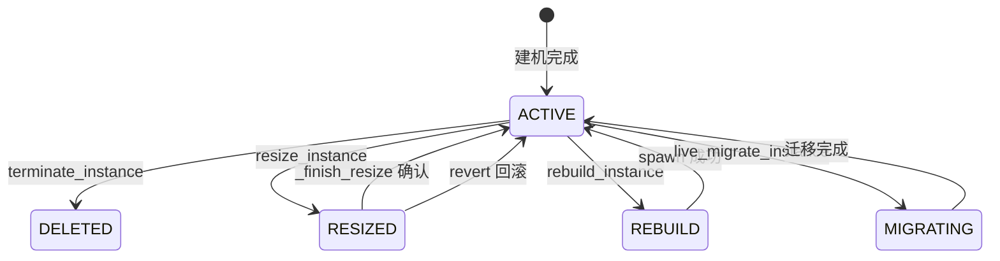

# `WF-02` · 实例删/重建/迁移/快照动作

实例动作的入口统一收敛到 `POST /servers/{id}/action`（`nova/api/openstack/compute/routes.py:787`），由 `ServersController` 按 action 名分发表执行。核心动作包括删除、重建（rebuild）、调整规格（resize）、迁移（migrate/live-migrate）与快照；编排层以 `nova/compute/api.py` 的领域 API 与 `nova/conductor/manager.py:212 ComputeTaskManager` 为主。

## 1. 符号级端到端执行调用树（End-to-End Symbolic Call Tree）

```text
Trigger: POST /servers/{id}/action -> nova/api/openstack/compute/routes.py:787 -> ServersController.action
  ├─ [delete] nova/api/openstack/compute/servers.py:828 delete -> nova/compute/api.py:2124 API.delete
  │    └─ conductor -> nova/compute/manager.py:2400 terminate_instance -> :2338 _delete_instance -> driver.destroy
  ├─ [rebuild] nova/compute/api.py:2907 API.rebuild -> nova/compute/manager.py:2678 rebuild_instance
  │    └─ :2813 _do_rebuild_instance -> driver.spawn（换镜像重新落机）
  ├─ [resize] nova/compute/api.py:3110 API.resize -> nova/compute/manager.py:3829 resize_instance
  │    └─ conductor.ComputeTaskManager -> :3922 _finish_resize 确认/回滚
  └─ [live-migrate] nova/conductor/manager.py:379 live_migrate_instance
       └─ nova/compute/manager.py -> nova/virt/driver.py:822 live_migration
```

## 2. 分阶段业务规则与分支判定表（Exact Code Rules & Thresholds）

| 阶段 | 负责函数（`路径:行号`） | 精确布尔条件 / 校验规则 / 阈值常量 | 命中分支行为 | 状态或数据副作用 |
|---|---|---|---|---|
| 动作分发 | `routes.py:787` | action 名映射到 controller 方法 | 未知动作 → 400 | 无 |
| 删除准入 | `servers.py:828` / `compute/api.py:2124` | 实例存在性 + `context.can` | 越权/不存在 → 403/404 | 无 |
| resize 确认超时 | `manager.py:5994 _poll_unconfirmed_resizes` | 周期任务按 `resize_time_out` 阈值 | 超时未确认 → 自动 confirm/revert | 改 `vm_state` |
| 重建镜像校验 | `compute/api.py:2907` | 新镜像可访问且 active | 失效 → 拒绝 | 无 |

## 3. 实体状态机与合法迁移约束



- **不可违反的业务不变量**：resize 未确认前迁移索引保留，`_poll_unconfirmed_resizes`（`nova/compute/manager.py:5994`）按超时驱动确认或回滚；删除必须经 `terminate_instance`（`:2400`）而非直接改库。

## 4. 幂等、并发互斥与异常补偿回滚表

| 边界 / 故障场景 | 源码检测条件（`路径:行号`） | 保护/回滚/降级动作 |
|---|---|---|
| resize 中途失败 | `conductor/manager.py:3922 _finish_resize` / `:351 _set_vm_state_and_notify` | 回滚到原规格并记录错误状态 |
| 迁移目标不可达 | `nova/virt/driver.py:822 live_migration` | 抛异常，`vm_state` 复位 |
| 删除并发 | `manager.py:6539 _reclaim_queued_deletes` | 排队删除由周期任务回收，避免竞态 |
| 卷未解绑 | cinder `detach`（`nova/volume/cinder.py:376`） | 删除前先 detach |

## 5. 共变耦合与修改清单（Agent Co-Change Playbook）

- 新增实例动作：`nova/api/openstack/compute/routes.py:787` 绑定 action → `nova/compute/api.py` 加领域方法 → `conductor/manager.py`/`compute/manager.py` 加编排与执行 → 更新 [`api-reference.md`](../contracts/api-reference.md) → 跑 `nova/tests/unit/compute/`。
- **状态机纪律**：任何新终态须登记到 `nova/compute/vm_states.py` 并核对白名单（`:69-78`），避免重启/资源回收判定遗漏。
