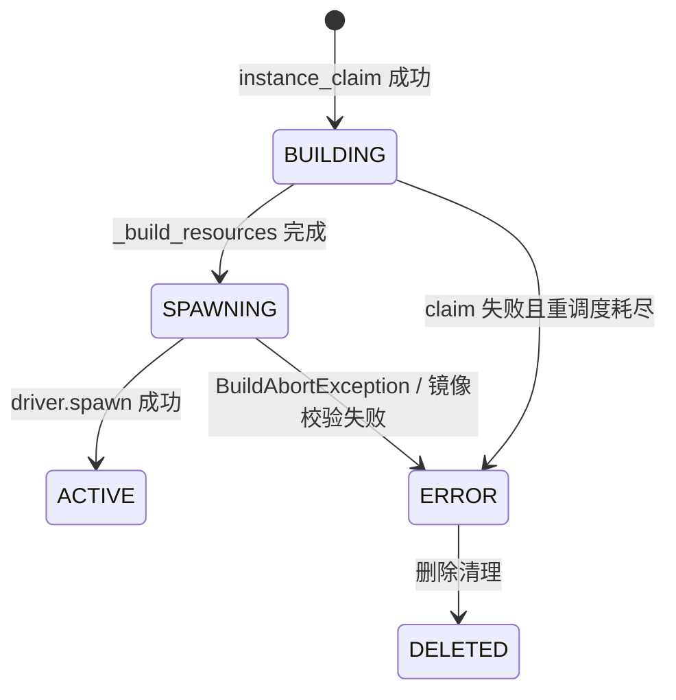

# `WF-01` · 实例创建与落机

租户通过 `POST /servers` 创建云主机：请求经 WSGI 鉴权、microversion 解析与配额预留后，由 conductor 选出目标节点，再异步 cast 到目标 `nova-compute` 执行资源 claim、卷/网络/镜像准备，最终调用 hypervisor `spawn`。这是全仓最长、跨进程最多的一条例行链。

## 1. 符号级端到端执行调用树（End-to-End Symbolic Call Tree）

```text
Trigger: POST /servers -> nova/api/openstack/compute/servers.py:453 ServersController.create(body)
  ├─ [Step 1: 解析+策略] servers.py:457-483 解析 name/password/tags -> context.can("compute:create", target)
  │    └─ 越权 -> raise（HTTP 403）
  ├─ [Step 2: 配额] nova/compute/api.py:1584 API.create(...) -> QuotaEngine.reserve (:1640)
  │    └─ 超限 -> 抛配额异常，无写入
  ├─ [Step 3: RPC 编排] nova/conductor/rpcapi.py:328 build_instances -> cctxt.cast("build_instances")
  │    └─ nova/conductor/manager.py:517 ComputeTaskManager.build_instances
  │         └─ 选节点 -> nova/scheduler/filter_scheduler.py:111 _schedule -> (host, node)
  │         └─ nova/conductor/manager.py:610 compute_rpcapi.build_and_run_instance(...)
  ├─ [Step 4: 落机] nova/compute/manager.py:1702 build_and_run_instance -> :1901 _build_and_run_instance
  │    ├─ [claim] :1921 rt.instance_claim -> 失败抛 ComputeResourcesUnavailable (:1958)
  │    ├─ [resources] :1928 _build_resources -> 卷/端口/镜像就绪
  │    ├─ [state] :1931 vm_state=BUILDING, task_state=SPAWNING
  │    └─ [spawn] :1943 driver.spawn -> nova/virt/libvirt/driver.py:2779
  └─ [Step 5: 提交] 成功 -> vm_state=ACTIVE；失败 -> RescheduledException 重调度 / BuildAbortException
```

## 2. 分阶段业务规则与分支判定表（Exact Code Rules & Thresholds）

| 阶段 | 负责函数（`路径:行号`） | 精确布尔条件 / 校验规则 / 阈值常量 | 命中分支行为（正常流 vs 拒绝/降级流） | 状态或数据副作用 |
|---|---|---|---|---|
| microversion 解析 | `servers.py:460` / `:473` | `is_supported(req, '2.19')` / `'2.52'` | 满足才注入 `description`/`tags` | 补 `create_kwargs` |
| 策略校验 | `servers.py:483` / `:494` | `context.can(SERVERS % 'create', target)`；forced_host 需 `create:forced_host` | 拒绝抛异常 | 无写入 |
| 资源 claim | `manager.py:1921` | `rt.instance_claim(context, instance, node, limits)` 成功 | 失败 → `ComputeResourcesUnavailable` → `RescheduledException`（`:1965`） | 预留/释放资源 |
| 状态提交 | `manager.py:1936` | `instance.save(expected_task_state=BLOCK_DEVICE_MAPPING)` | 乐观锁冲突则失败 | 写 `vm_state`/`task_state` |
| 镜像签名校验 | `glance.py:299` | `CONF.glance.verify_glance_signatures` | 启用则校验，失败拒绝 | 下载中断 |

## 3. 实体状态机与合法迁移约束



- **不可违反的业务不变量**：`vm_state` 仅在流程终态改写，`task_state` 表达中间阶段；二者字面量分别来自 `nova/compute/vm_states.py:34` 与 `nova/compute/task_states.py:29`。claim 必须在校验之前（`manager.py:1922-1926` 注释明确 host 在 claim 时才确定）。

## 4. 幂等、并发互斥与异常补偿回滚表

| 边界 / 故障场景 | 源码检测条件（`路径:行号`） | 保护/回滚/降级动作 |
|---|---|---|
| 同一实例并发建机 | `manager.py:1709 _locked_do_build_and_run_instance` | 加锁串行化 |
| claim 资源不足 | `manager.py:1958 ComputeResourcesUnavailable` | 抛 `RescheduledException`（`:1965`）重调度到别的 host |
| 建机中途异常 | `conductor/manager.py:1072 _cleanup_build_artifacts` / `:865 _bury_in_cell0` | 清理卷/网络并 bury 到 cell0 |
| 配额未释放 | `nova/quota.py:787 rollback` | 异常路径回滚预留 |
| 镜像下载签名不符 | `glance.py:299` | 拒绝镜像、实例置 ERROR |

## 5. 共变耦合与修改清单（Agent Co-Change Playbook）

- **修改建机规则必查联动点**：
  1. 入向参数与策略：`nova/api/openstack/compute/servers.py:453`
  2. RPC 载荷版本协商：`nova/conductor/rpcapi.py:328`
  3. 下游字典拼装：`integrations/downstream/glance.md`、`cinder.md`、`neutron.md`
  4. 状态字面量：`nova/compute/vm_states.py`、`nova/compute/task_states.py`
  5. 必跑闭环回归：`nova/tests/unit/compute/test_compute.py`、单测映射见 [`dev-and-test.md`](../operations/dev-and-test.md)
