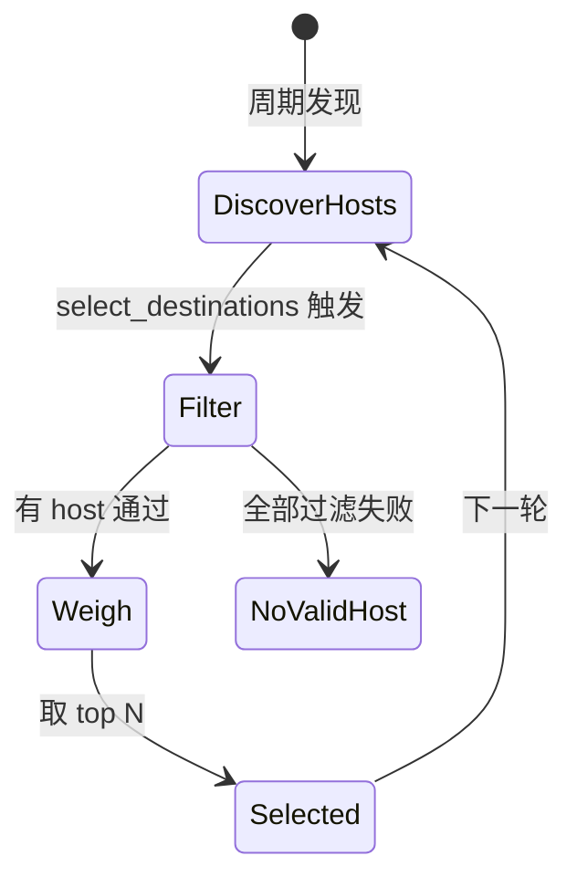

# `WF-03` · 调度选节点

当 conductor 收到建机/迁移请求时，通过 RPC 调用 scheduler 的 `select_destinations`，调度器以「过滤（filters）+ 权重（weighers）」从候选宿主机中按序选出目标。调度是只读决策：产出 `(host, node)` 列表，不直接写库或调 hypervisor。驱动由 `setup.cfg:84-88` 的 stevedore 入口决定。

## 1. 符号级端到端执行调用树（End-to-End Symbolic Call Tree）

```text
Trigger: conductor RPC call -> nova/scheduler/rpcapi.py select_destinations(...)
  -> nova/scheduler/manager.py:105 SchedulerManager.select_destinations(ctxt, request_spec, filter_properties, ...)
     └─ [dispatch] self.scheduler_driver.select_destinations(...)
        └─ nova/scheduler/filter_scheduler.py:111 FilterScheduler._schedule(context, spec_obj, ...)
           ├─ [1. 候选] self.host_manager.get_all_host_states(...) -> HostState 列表
           ├─ [2. 过滤] self.host_manager.get_filtered_hosts(host_states, spec_obj, ...) (:295)
           │    └─ 逐个 filter 过滤；全失败 -> NoValidHost
           ├─ [3. 权重] self.host_manager.get_weighed_hosts(filtered_hosts, spec_obj, ...) (:303)
           └─ [4. 选择] 取 top N -> [(host, node, limits)]
```

## 2. 分阶段业务规则与分支判定表（Exact Code Rules & Thresholds）

| 阶段 | 负责函数（`路径:行号`） | 精确布尔条件 / 校验规则 / 阈值常量 | 命中分支行为 | 状态或数据副作用 |
|---|---|---|---|---|
| RPC 入口 | `manager.py:105` | `select_destinations(ctxt, request_spec, filter_properties, ...)` | 参数非法 → 异常 | 无 |
| 候选获取 | `filter_scheduler.py:111` | `get_all_host_states` 读宿主机状态 | 无 host → `NoValidHost` | 无 |
| 过滤 | `host_manager.py`（经 `filter_scheduler.py:295`） | 每个 filter 的 `host_passes` 全部为真 | 不过滤除 | 无 |
| 权重排序 | `filter_scheduler.py:303` | weigher 计算权重降序 | top N 入选 | 无 |
| 周期发现 | `manager.py:90 _discover_hosts_in_cells` | 周期从 cells 发现新 host | 更新候选集 | 内存 host state |

## 3. 状态机与选择约束

调度本身无持久状态机，但受资源预留约束：



- **不可违反的约束**：`_expire_reservations`（`nova/scheduler/manager.py:84`）清理过期预留，防止容量虚占导致重复调度到同一 host。

## 4. 幂等、并发互斥与异常补偿回滚表

| 边界 / 故障场景 | 源码检测条件（`路径:行号`） | 保护/回滚/降级动作 |
|---|---|---|
| 无可用 host | `filter_scheduler.py:295` 过滤后为空 | 抛 `NoValidHost`，建机失败 |
| 预留过期 | `manager.py:84 _expire_reservations` | 周期回收 |
| 驱动实现差异 | `setup.cfg:84-88` | `CachingScheduler`/`ChanceScheduler` 可替换，接口一致 |

## 5. 共变耦合与修改清单（Agent Co-Change Playbook）

- 新增过滤/权重规则：在 `nova/scheduler/filters/` 或 `nova/scheduler/weights/` 加类 → 配置启用 → 跑 `nova/tests/unit/scheduler/`。
- 改 `select_destinations` RPC 签名：同步 `nova/scheduler/rpcapi.py` 与 `nova/conductor/manager.py:621 _schedule_instances` 的 call 端。
- **影响面**：调度只产出目标，真正状态变更在 [`wf-instance-boot.md`](wf-instance-boot.md) 的 claim 与 spawn 阶段。
