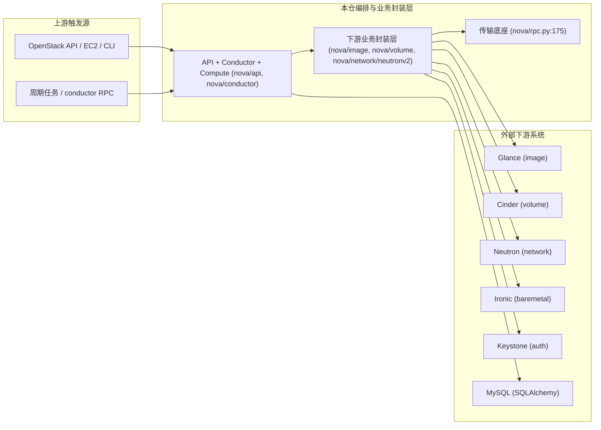

# 上下游集成与调用拓扑总览

本页汇总 Nova 全部组件「上游被谁调 ↔ 下游调了谁」的双向拓扑，并完整登记所有外部下游依赖系统的业务封装入口。Nova 的外部依赖分两类：RPC 底座（`oslo.messaging`）承载内部服务通信，SDK 封装层承载对 Glance/Cinder/Neutron/Ironic/Keystone 的调用。

## 1. 上下游调用拓扑图（Inbound ↔ Internal ↔ Outbound）

## 2. 仓内组件「上游有谁 ↔ 下游调谁」双向速查表

| 本仓组件 / 模块 | 源码路径 | 直接上游调用方（符号 + `路径:行号`） | 调用的仓内下游模块 | 调用的外部下游封装 | 组件架构页 |
|---|---|---|---|---|---|
| API 接入 | `nova/api/openstack/compute/servers.py:66` | 租户 / SDK（HTTP） | `compute/api.py:243` | Keystone 鉴权 | [`api-service.md`](../architecture/api-service.md) |
| Conductor 编排 | `nova/conductor/manager.py:212` | `API.create` | scheduler / compute（RPC） | MySQL (`nova/db/sqlalchemy/api.py`) | [`conductor-engine.md`](../architecture/conductor-engine.md) |
| Compute Worker | `nova/compute/manager.py:1702` | conductor RPC cast (`:610`) | `virt/driver.py:93` | Glance, Cinder, Neutron | [`compute-worker.md`](../architecture/compute-worker.md) |
| Virt 驱动 | `nova/virt/driver.py:93` | compute `spawn` (`manager.py:1943`) | — | Ironic, hypervisor | [`virt-and-data.md`](../architecture/virt-and-data.md) |

## 3. 外部下游依赖系统全量清单（Downstream Registry）

> **强制区分传输底座与业务封装层**：`nova/rpc.py` 是传输底座；真正组装业务字典的是 `nova/image/`、`nova/volume/`、`nova/network/neutronv2/`、`nova/virt/ironic/` 下的封装模块，逐一下游独立成篇。

| 下游系统名 | 承担业务职责 | 协议与成功判定 | 底层传输基类（`路径:行号`） | 本仓业务封装文件（组装参数层） | 超时 / 重试配置 | 出向字典契约专页 |
|---|---|---|---|---|---|---|
| `glance` | 镜像元数据/上传下载 | `glanceclient` v2，HTTP 异常翻译 | `GlanceClientWrapper` (`nova/image/glance.py:126`) | `nova/image/glance.py:189` | `num_retries` 默认 `0` | [`downstream/glance.md`](downstream/glance.md) |
| `cinder` | 卷创建/挂卸载/快照 | `cinderclient` v3，异常翻译 | `cinderclient()` (`nova/volume/cinder.py:82`) | `nova/volume/cinder.py:309` | `http_retries` 默认 `3` | [`downstream/cinder.md`](downstream/cinder.md) |
| `neutron` | 端口/网络/安全组 | `neutronclient` v2.0 | `get_client` (`nova/network/neutronv2/api.py:122`) | `nova/network/neutronv2/api.py:231` | `url`/`region_name` 配置 | [`downstream/neutron.md`](downstream/neutron.md) |
| `ironic` | 裸金属节点管理 | `ironicclient`（动态导入） | `IronicClientWrapper` (`nova/virt/ironic/client_wrapper.py:36`) | `nova/virt/ironic/client_wrapper.py` | 冲突重试 `retry_on_conflict` | [`downstream/ironic.md`](downstream/ironic.md) |
| `keystone` | 身份认证/服务目录 | `keystoneauth1` 会话插件 | `get_auth_plugin` (`nova/service_auth.py:25`) | `nova/service_auth.py` | 由 keystoneauth 配置 | [`downstream/keystone.md`](downstream/keystone.md) |
| `mysql` | 结构化数据持久化 | SQLAlchemy ORM，参数化 SQL | `sqlalchemy_api.configure` (`nova/config.py:58`) | `nova/db/sqlalchemy/api.py` | 连接由 conf 管理 | [`downstream/mysql.md`](downstream/mysql.md) |

字段级入向→出向映射见 [参数组装与字段映射矩阵](topology-and-mapping.md)；错误翻译见 [错误码字典](../contracts/error-codes.md)。

## 4. 共变耦合与修改清单（Agent Co-Change Playbook）

新增下游系统时：在 [transmission 底座](../architecture/virt-and-data.md) 确认复用 `nova/rpc.py` 或 SDK 会话 → 在 `nova/<module>/` 建立业务封装（组装请求字典 + 解包返回字段）→ 新建 `integrations/downstream/<target>.md` 独立契约页 → 更新 [拓扑映射](topology-and-mapping.md) 与 [错误码字典](../contracts/error-codes.md) → 在 [配置手册](../contracts/configuration.md) 登记端点/凭据键 → 跑对应单测。
