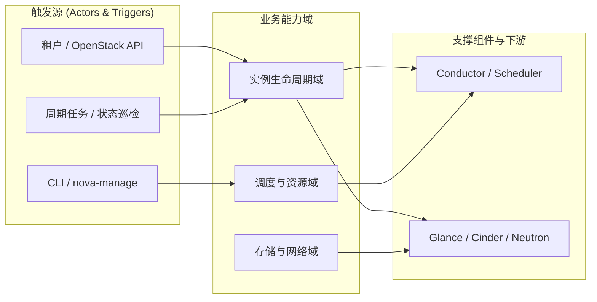

# 业务架构全景

Nova 面向两类触发角色：终端用户/租户通过 OpenStack Compute API（或 EC2 兼容接口）管理虚机生命周期，运维通过 CLI/内部 RPC 管理宿主机与集群；核心业务闭环是「接收建机请求 → 鉴权配额 → 调度选节点 → 编排建卷联网 → hypervisor 落机 → 状态收敛」。全部业务域围绕有状态的 `Instance` 实体展开。

## 1. 角色触发源与业务域拓扑

## 2. 业务域边界与能力矩阵

| 业务域标识 | 业务域名称 | 核心业务职责 | 核心状态实体 | 归属代码模块 | 核心准入/配额约束 | 关联业务清单 |
|---|---|---|---|---|---|---|
| `DOM-01` | 实例生命周期域 | 创建/删除/重建/开机/快照/接管虚机 | `Instance`, `InstanceAction` | `nova/compute/api.py:243` / `nova/api/openstack/compute/servers.py:66` | 项目配额、策略授权（`servers.py:483 context.can`） | [业务总表](../business/index.md) |
| `DOM-02` | 调度与资源域 | 过滤+权重选节点、资源账本对齐、聚合/可用域管理 | `ComputeNode`, `Aggregate` | `nova/scheduler/filter_scheduler.py:111` / `nova/compute/resource_tracker.py:128` | 过滤条件、资源 claim（`resource_tracker.py:152 instance_claim`） | [调度流程](../business/wf-scheduling.md) |
| `DOM-03` | 存储与网络域 | 卷挂卸载、端口分配、镜像拉取 | `BlockDeviceMapping`, `VirtualInterface` | `nova/volume/cinder.py:309` / `nova/network/neutronv2/api.py:357` | 跨可用域挂载开关 `cross_az_attach`（`nova/conf/cinder.py:82`） | [入向接口](../contracts/api-reference.md) |

## 3. 全量业务流程主索引（`WF-*`）

| 流程 ID | 流程名称 | 触发入口（路由 / 定时器 / 命令） | 串联组件与下游（按执行序） | 关键状态迁移 | 流程专页 |
|---|---|---|---|---|---|
| `WF-01` | 实例创建与落机 | `POST /servers` (`nova/api/openstack/compute/servers.py:453`) | `ServersController → API.create → Conductor.build_instances → Scheduler → Compute.build_and_run_instance → Virt.spawn` | `BUILD → SPAWNING → ACTIVE` | [`business/wf-instance-boot.md`](../business/wf-instance-boot.md) |
| `WF-02` | 实例删/重建/迁移 | `POST /servers/{id}/action` (`nova/api/openstack/compute/routes.py:787`)、`nova/compute/api.py:2907` / `:3110` | `API → Conductor.ComputeTaskManager → Compute.manager → Virt` | `ACTIVE → REBUILD/RESIZE → ACTIVE` | [`business/wf-instance-actions.md`](../business/wf-instance-actions.md) |
| `WF-03` | 调度选节点 | RPC `select_destinations` (`nova/scheduler/manager.py:105`) | `SchedulerManager → FilterScheduler._schedule → HostManager → filters/weights` | 无持久状态、产出目标 host | [`business/wf-scheduling.md`](../business/wf-scheduling.md) |
| `WF-04` | 周期状态收敛 | `nova/manager.py:104 periodic_tasks` | `ComputeManager 周期任务 → ResourceTracker → Virt.get_host_stats` | 对齐 `power_state`/`vm_state` | [`operations/runbook-and-observability.md`](../operations/runbook-and-observability.md) |

## 4. 全局业务不变量（不可破坏的业务红线）

每条均附源码强制校验位置：

1. **权限与资源归属不变量**：每个实例动作必须先过 `context.can(action, target)` 策略校验，target 带 `project_id`/`user_id` —— 校验锚点：`nova/api/openstack/compute/servers.py:479-483`。
2. **配额预留与回滚不变量**：建机前 `QuotaEngine.reserve`，失败路径必须 `rollback`，成功才 `commit` —— 校验锚点：`nova/quota.py:1640`、`nova/quota.py:787`、`nova/quota.py:764`。
3. **状态迁移白名单不变量**：软重启仅允许 `ACTIVE`，硬重启额外允许 `STOPPED/PAUSED/SUSPENDED/ERROR` —— 校验锚点：`nova/compute/vm_states.py:69-72`。
4. **版本协商与向后兼容不变量**：microversion 决定请求字段是否生效（如 `2.19` 才有 description、`2.52` 才有 tags）—— 校验锚点：`nova/api/openstack/compute/servers.py:460-474`。
5. **compute 禁直连 DB 不变量**：`nova-compute` 启动即 `block_db_access`，对象读写改走 conductor RPC —— 校验锚点：`nova/cmd/compute.py:46-47`。

完整流程清单见 [业务能力与核心流程总清单](../business/index.md)，状态枚举见 [术语表](glossary.md)。
