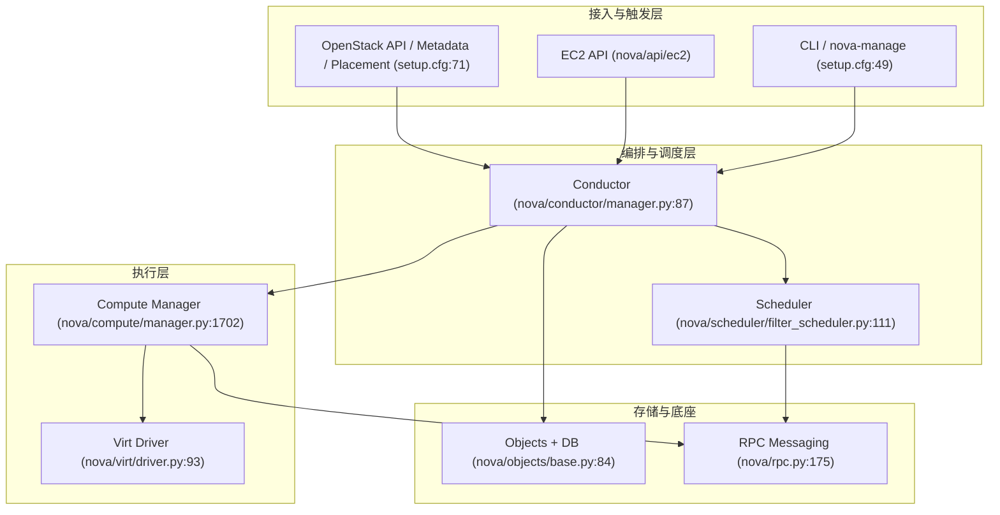

# 系统技术架构

Nova 是 OpenStack 的云计算结构控制器：Python 2.7/3.5、基于 `pbr`/`setuptools` 打包、以多进程守护服务形态运行，通过 `oslo.messaging`（默认 RabbitMQ）在 API/调度/编排/计算服务间通信，由 `nova-compute` 直连 hypervisor 执行虚机生命周期。核心红线是「无状态 HTTP/编排层禁止直连数据库与 hypervisor」。

## 1. 运行时分层与依赖拓扑



| 架构层 | 包含目录 / 文件 | 核心职责 | 越界禁令（Agent 修改红线） |
|---|---|---|---|
| 接入与触发层 | `nova/api/openstack/`、`nova/api/ec2/`、`nova/api/metadata/`、`nova/api/validation/`、`setup.cfg:49` | 协议解析、microversion 协商、策略鉴权、参数校验 | HTTP 层禁止拼装 SQL 或直接调用 hypervisor；统一经 compute/conductor API |
| 编排与调度层 | `nova/conductor/`、`nova/scheduler/` | 无状态任务编排、DB 代理、过滤+权重选节点 | conductor 不直连 hypervisor；调度只产出目标节点列表 |
| 执行层 | `nova/compute/`、`nova/virt/` | 实例状态机、资源账本、hypervisor 驱动适配 | 驱动层禁止感知 HTTP 框架对象；阻塞 IO 经周期任务收敛 |
| 存储与底座层 | `nova/objects/`、`nova/db/`、`nova/rpc.py`、`nova/conf/` | 带版本领域对象、SQLAlchemy 持久化、RPC 传输、配置注册 | 外部地址/凭据一律走配置项，禁止硬编码；SQL 一律参数化 |

## 2. 进程启动装配与停机序列（Bootstrap Call Tree）

所有服务共用 `main → config.parse_args → service.Service.create → serve → wait` 骨架，以 `nova-compute` 为例：

```text
nova/cmd/compute.py:42 main()
  ├─ [1. config] nova/config.py:33 parse_args(sys.argv) -> 注册 oslo.config 选项、初始化日志
  │    └─ nova/config.py:55 rpc.init(CONF) + nova/config.py:58 sqlalchemy_api.configure(CONF)
  ├─ [2. identity] priv_context.init(root_helper=...) -> 提权上下文（rootwrap）
  ├─ [3. objects] objects.register_all() -> 注册全部带版本领域对象
  ├─ [4. db-guard] nova/cmd/compute.py:46 block_db_access('nova-compute') -> 禁用直连 DB
  ├─ [5. conductor-proxy] NovaObject.indirection_api = ConductorAPI() -> 对象读写走 conductor
  ├─ [6. service] nova/service.py:98 Service.create(binary='nova-compute', topic=compute_rpcapi.RPC_TOPIC)
  ├─ [7. serve] nova/service.py:425 serve(server) -> 启动 RPC server 与周期任务
  └─ [8. wait] nova/service.py:434 wait() -> 阻塞直到信号；nova/service.py:258 stop() 释放资源
```

WSGI 服务走另一条装配链：pbr 的 `wsgi_scripts`（`setup.cfg:71`）暴露 `init_application`，例如 `nova/api/metadata/wsgi.py:19` 与 `nova/api/openstack/placement/wsgi.py:50` 均委托 `nova/api/openstack/wsgi_app.py:73 init_application(name)`，后者读取 paste 配置并 `deploy.loadapp`。

## 3. 跨切面工程机制速查表

| 机制维度 | 核心符号与源码锚点 | 全局实现规则 |
|---|---|---|
| 认证鉴权与策略隔离 | `nova/policy.py:126 authorize(context, action, target)` | 每个 API 动作经 `context.can` 校验，管理员判定 `nova/policy.py:172 check_is_admin`；规则由 `setup.cfg:39` 的 `nova.policies` 入口注册 |
| 对象版本与 RPC 序列化 | `nova/objects/base.py:184 NovaObjectSerializer` / `nova/rpc.py:122 RequestContextSerializer` | 跨服务传输的对象经 `serialize_entity`（`nova/objects/base.py:242`）转为 primitive，请求上下文由 `nova/rpc.py:137 serialize_context` 注入 |
| RPC 通信与 cast/call | `nova/rpc.py:175 get_client` / `nova/rpc.py:189 get_server` | `cast` 异步投递、`call` 同步等待；`nova/rpc.py:397 ClientRouter` 提供客户端代理与版本协商 |
| 周期任务与并发卸载 | `nova/manager.py:104 Manager.periodic_tasks` | 所有守护服务继承 `nova/manager.py:91 Manager`，周期任务由 `oslo_service.periodic_task` 驱动，实例状态对齐见 `nova/compute/manager.py:6303 _sync_power_states` |
| 配额预定与回滚 | `nova/quota.py:1640 QuotaEngine.reserve` / `nova/quota.py:787 rollback` | 资源变更先 `reserve` 再 `commit`（`nova/quota.py:764`），异常路径 `rollback` 释放预留 |
| 异常到协议状态映射 | `nova/exception.py:58 NovaException` / `nova/exception.py:35 ConvertedException` | 业务异常统一继承 `NovaException`，Web 层经 `ConvertedException` 映射为 HTTP 状态（全表见 [错误码字典](../contracts/error-codes.md)） |
| 外部边界与降级 | `nova/virt/driver.py:93 ComputeDriver` / `nova/service_auth.py:25 get_auth_plugin` | 外部系统统一经 driver/wrapper 适配，无配置时按 wrapper 约定降级（详见 [上下游集成总览](../integrations/index.md) 与 [认知边界声明](../operations/boundary.md)） |

组件逐个归类见 [组件技术架构总表](../architecture/index.md)；启动后的主干调用流见 [主干调用链全景](callchain-panorama.md)。


## 4. 跨切面机制的共变修改清单（Agent Co-Change Playbook）

- 改认证策略：`nova/policy.py:126` → `nova/policies/` 规则 → 各 controller 的 `context.can` → 跑 `nova/tests/unit/api/`。
- 改 RPC 序列化：`nova/objects/base.py:184` → 全量 conductor/compute 集成测试。
- 改配额：`nova/quota.py:1419` → `reserve`/`commit`/`rollback` 三处 → 跑 `nova/tests/unit/test_quota.py`。
- 各层越界红线见 [组件技术架构总表](../architecture/index.md) 与 [高危雷区与历史陷阱](../operations/pitfalls-and-adr.md)。
